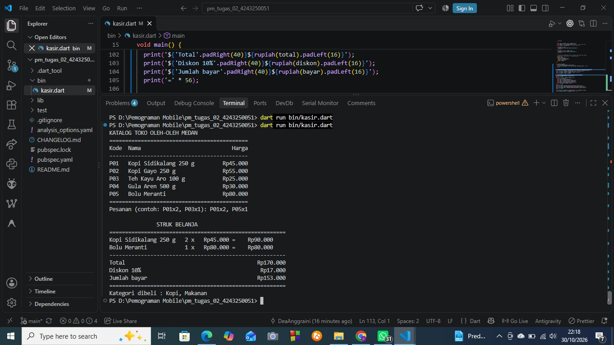

# Tugas Rutin 2: Kasir Console Toko Oleh-oleh Medan

## Identitas
- Nama: Dea Anggraini
- NIM: 4243250051
- Kelas: PSIK 24 C
- Mata kuliah: Pemrograman Mobile (3KOM40215)

## Cara menjalankan
dart run bin/kasir.dart

## Tangkapan layar
### Skenario 1: pesanan valid

### Skenario 2: pesanan dengan kode salah

## Penjelasan
Dalam tugas ini saya belajar bahwa var, final, dan const sama-sama dipakai untuk menyimpan nilai, tapi aturannya beda. var nilainya boleh berubah-ubah, contohnya variabel i di perulangan pada baris 7. final cuma boleh diisi sekali, tapi nilainya baru ditentukan saat program jalan, seperti final total di baris 86 yang dihitung dari pesanan pengguna. const juga tidak bisa diubah, tapi nilainya harus sudah pasti sejak kode ditulis, jadi const x = DateTime.now() akan error karena waktu baru diketahui saat program berjalan.

Soal null safety, katalog[kode] bisa menghasilkan null kalau kode produknya tidak ada di katalog. Di baris 57 saya menyimpannya ke variabel produk, lalu di baris 59 saya cek if (produk == null). Kalau null, item itu dicatat sebagai ditolak dan program lanjut ke item berikutnya. Karena sudah dicek, Dart tahu produk pasti berisi data setelahnya, jadi saya tidak perlu tanda seru (!). Kalau pengecekan itu dihapus dan saya ketik P09x3, program tidak mau dikompilasi, atau kalau dipaksa pakai !, program langsung crash.

## Pernyataan Penggunaan AI
Saya menggunakan AI untuk contoh kode awal. Kode saya ketik ulang, uji sendiri dengan beberapa skenario, dan saya pelajari cara kerjanya.